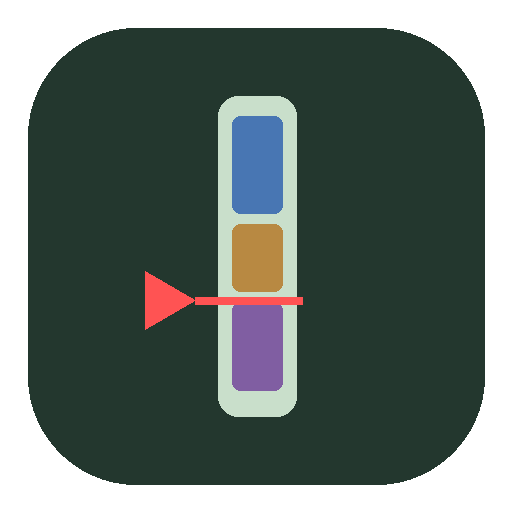
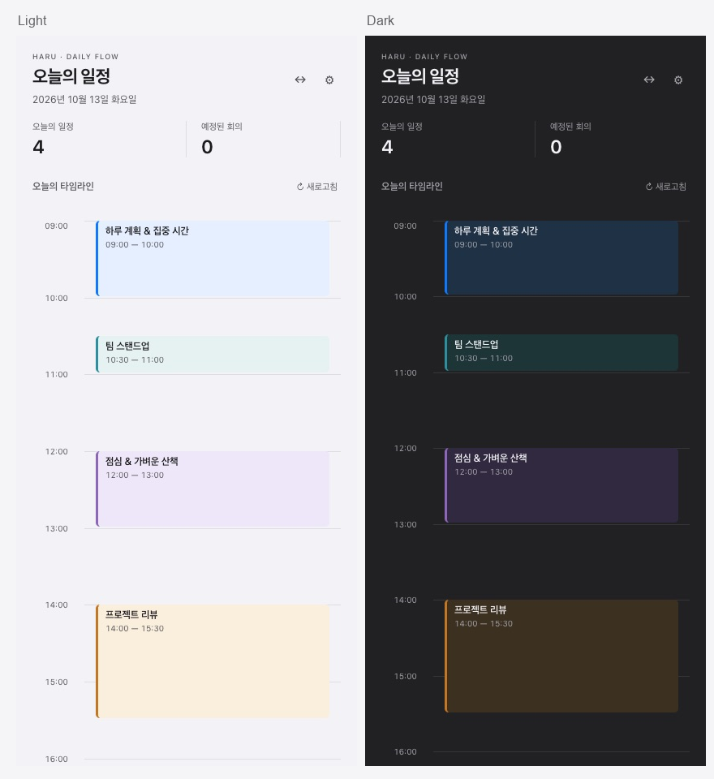

<h1 align="center">Haru · 하루</h1>

<strong>하루의 흐름은 보이게. 작업은 방해하지 않게.</strong> 화면 가장자리에서 일정과 할일을 보여 주는 Google Calendar 위젯.

  
  
  
  

<a href="https://github.com/ingjae/haru/releases/latest">다운로드</a> · <a href="docs/INSTALL.md">설치</a> · <a href="docs/USAGE.md">사용법</a> · <a href="docs/GOOGLE_SETUP.md">Google 연결</a>

Haru는 **24px 레일**로 오늘의 일정 분포와 현재 시간을 계속 보여 줍니다. 기본 시간 범위는 **09:00–21:00**이며 원하는 시간으로 바꿀 수 있습니다. 레일을 클릭하면 상세 화면이 펼쳐지고, 다른 곳을 클릭하면 다시 접힙니다. 마우스를 올리는 것만으로 확장되지 않습니다.

## 주요 기능

| 기능 | 할 수 있는 일 |
| --- | --- |
| 항상 보이는 타임라인 | 일정 색상 블록, 빨간 현재 시간 선과 레일 밖 삼각형 표시 |
| 일정 관리 | 빈 시간 클릭 또는 **＋**로 생성, 제목·시간·설명·장소·알림 수정, 삭제 |
| 종일·반복 일정 | 종일 일정 편집, 매일·매주·매월·매년 반복 생성, 선택한 회차 수정·삭제 |
| Google 할일 | 생성·수정·삭제, 완료 체크, **오늘 완료한 항목만 표시** |
| 날짜·목록 선택 | 날짜 이동, 캘린더·할일 목록 선택, 일정/할일 표시를 각각 켜고 끄기 |
| 회의 참가 | 상세 화면에서 Meet·Zoom·Teams 링크 열기, Google 캘린더 바로 열기 |
| 표시 설정 | 배경·세로 제목·전체 투명도·시간 범위, 시스템 밝은/어두운 모드 |
| macOS 메뉴바 | 가로 타임라인, 120–1200px 또는 자동 최대 폭, 클릭 상세 패널 |

**v0.0.4 추가 기능:** 짧은 일정 제목 잘림·한글 글꼴 보완, 실제 알림 켜기/끄기와 레일 옆 말풍선 애니메이션을 추가했습니다. 할일에 시작·종료 시간을 지정하면 Google 캘린더에도 시간 블록을 함께 저장합니다. v0.0.4 다운로드에 포함됩니다. 시간 없는 할일은 날짜 단위로 표시합니다. 오늘 완료한 할일은 예정 날짜와 관계없이 오늘 화면에 남고, 이전 완료 항목은 숨깁니다. 설정과 편집 중에는 펼친 화면을 유지합니다.

## 다운로드

| 플랫폼 | 배포 파일 | 설치 안내 |
| --- | --- | --- |
| macOS · Apple Silicon | [Haru-0.0.4-arm64.dmg](https://github.com/ingjae/haru/releases/download/v0.0.4/Haru-0.0.4-arm64.dmg) | [Mac 설치](docs/INSTALL.md#macos--apple-silicon) |
| Ubuntu 24.04 · x86_64 | [Haru-0.0.4-x86_64.AppImage](https://github.com/ingjae/haru/releases/download/v0.0.4/Haru-0.0.4-x86_64.AppImage) | [Linux 설치](docs/LINUX.md) |

[릴리즈와 체크섬](https://github.com/ingjae/haru/releases/latest) · Mac 패키지는 서명·공증하지 않은 개발 버전입니다. Linux의 화면 배치는 데스크톱 환경에 따라 제한될 수 있습니다. 긴 시스템 메뉴바 타임라인과 다른 앱의 창 공간 보정은 macOS 전용입니다.

## 버전별 검증

**실기기 테스트는 개발에 사용 중인 Apple Silicon MacBook 한 대에서만 확인했습니다.** 다른 Mac, Intel Mac, Linux 실기기는 아직 테스트하지 않았습니다. **PASS는 아래에 적힌 확인 범위만 뜻하며 전체 기능의 검증 완료를 의미하지 않습니다.**

  
  
  

| 버전 | 현재 MacBook · 실기기 | Ubuntu 24.04 · 실기기 | 자동 검증 |
| --- | --- | --- | --- |
| [v0.0.4](https://github.com/ingjae/haru/releases/tag/v0.0.4) | ✅ **PASS** · 현재 MacBook arm64 패키지 실행·설정 버전 표시 | ⬜ **NOT TESTED** | ✅ [Mac/Linux CI](https://github.com/ingjae/haru/actions/runs/38558357427), [Ubuntu AppImage·Xvfb 실행](https://github.com/ingjae/haru/actions/runs/38558357336) |
| [v0.0.3](https://github.com/ingjae/haru/releases/tag/v0.0.3) | ✅ **PASS** · arm64 패키지 실행·화면·버전 표시 | ⬜ **NOT TESTED** | ✅ [Mac/Linux CI](https://github.com/ingjae/haru/actions/runs/38512005402), [Ubuntu AppImage 빌드·Xvfb 샘플 실행](https://github.com/ingjae/haru/actions/runs/38513958682) |
| [v0.0.2](https://github.com/ingjae/haru/releases/tag/v0.0.2) | ✅ **PASS** · arm64 패키지 실행 | — Linux 배포 없음 | ✅ [CI](https://github.com/ingjae/haru/actions/runs/38379026435) |
| [v0.0.1](https://github.com/ingjae/haru/releases/tag/v0.0.1) | ✅ **PASS** · arm64 패키지 실행 | — Linux 배포 없음 | 로컬 테스트·DMG 무결성 확인 |

실제 Google 일정·할일 **조회**는 현재 MacBook의 개발 실행에서 확인했습니다. 실제 계정의 생성·수정·삭제 전체 흐름과 Linux Google 연결은 아직 미검증입니다. Ubuntu의 Xvfb 실행은 **CI 가상 화면 검증**이며 Linux 실기기 PASS로 계산하지 않습니다. [상세 검증 범위](docs/USAGE.md#지원-범위와-검증)

## 시작하기

1. 플랫폼에 맞게 [설치](docs/INSTALL.md)합니다. 연결 전에는 샘플 일정이 표시됩니다.
2. **⚙ 설정 → Google 캘린더 연결**에서 데스크톱 OAuth JSON으로 로그인합니다. [Google 설정 안내](docs/GOOGLE_SETUP.md)
3. 캘린더 목록과 할일은 **캘린더 목록·Google 할일 권한 연결**을 선택합니다. 같은 프로젝트의 Tasks API도 활성화해야 합니다.
4. 빈 시간대를 클릭해 일정을 만들거나, **＋ → 할일**을 선택합니다.

Google Calendar 전체 기능을 대체하지는 않습니다. 참석자 초대·Meet 생성, 전체 반복 편집은 아직 지원하지 않습니다. [기능 범위와 검증 상태](docs/USAGE.md#지원-범위와-검증)

## 더 알아보기

[사용법·표시 설정](docs/USAGE.md) · [사용 예시 영상](docs/MEDIA.md#사용-예시-영상) · [개발·기여](CONTRIBUTING.md) · [변경 이력](CHANGELOG.md) · [버그 제보](https://github.com/ingjae/haru/issues) · [보안](SECURITY.md)

OAuth와 일정·할일은 이 기기에서 Google과 직접 통신합니다. 인증은 시스템 키링으로 보호하며 저장소에 포함하지 않습니다.

[MIT License](LICENSE) · Copyright © 2026 ingjae

### 주·월 보기

상단 일·주·월 버튼으로 보기를 선택합니다. 주·월은 최대 1180px로 확대되며 화면 안에 맞춥니다. 월은 월요일 기준 6주 달력, 주는 7일 목록입니다. 날짜 숫자는 일 보기, ＋는 해당 날짜 일정·할일 생성, 일정 제목은 상세 편집으로 연결됩니다. 이전·다음은 선택한 보기 단위로 이동합니다. 날짜 안의 일정이 많으면 해당 칸을 스크롤합니다. v0.0.4부터 지원합니다.

v0.0.4: 상단 **캘린더**에서 표시할 캘린더·할일 목록을 여러 개 선택할 수 있습니다. 기존 항목은 원래 그룹에 수정되며 완료한 할일은 체크된 네모·취소선으로 표시됩니다.

최신 릴리즈는 **v0.0.4**입니다. 주·월 보기, 그룹 색상과 정리한 설정 UI를 포함합니다. [릴리즈 변경 사항과 검증 상태](docs/releases/v0.0.4.md)
