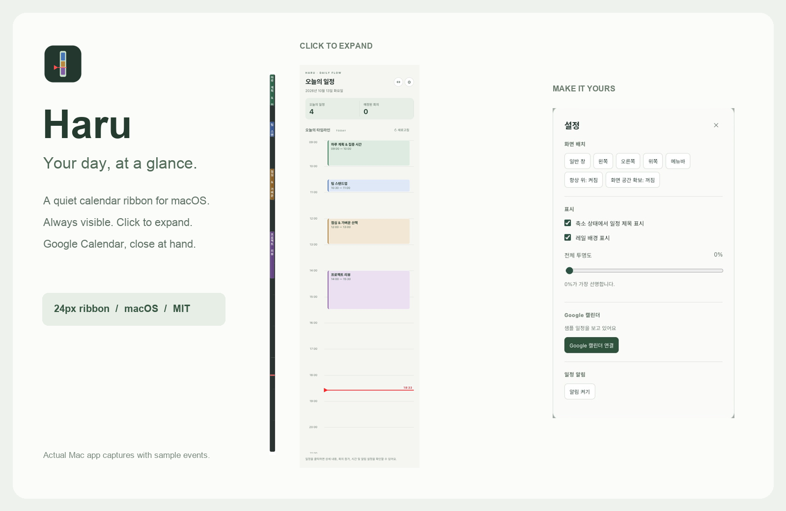
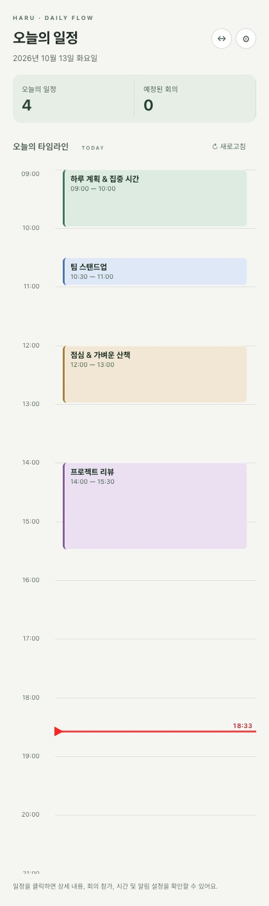
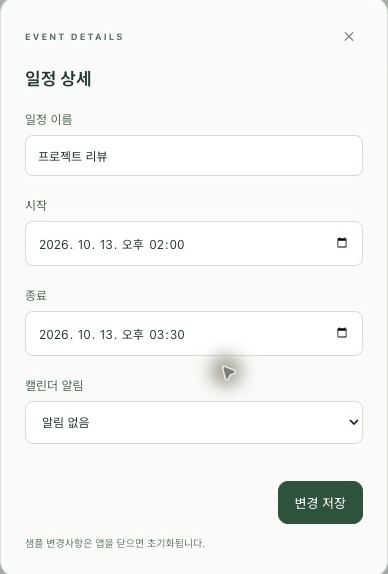
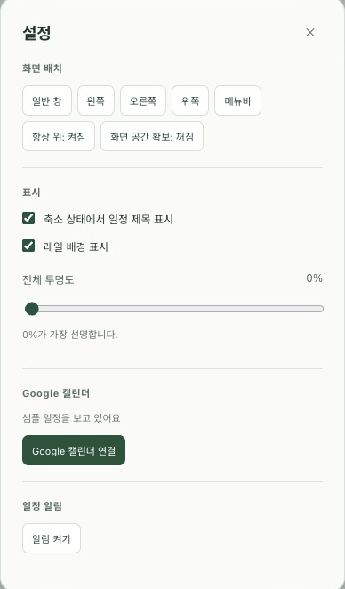

<p align="center"></p>
<h1 align="center">Haru · 하루</h1>
<p align="center"><strong>하루의 흐름은 보이게. 작업은 방해하지 않게.</strong><br>macOS 화면 가장자리에 머무는 Google Calendar 타임라인.</p>
<p align="center">
  <a href="https://github.com/ingjae/haru/releases"></a>
  <a href="LICENSE"></a>
  
  <a href="https://github.com/ingjae/haru/actions/workflows/ci.yml"></a>
</p>
<p align="center"><a href="https://github.com/ingjae/haru/releases/latest">다운로드</a> · <a href="#사용-예시">사용 예시</a> · <a href="docs/GOOGLE_SETUP.md">Google 연결</a> · <a href="CONTRIBUTING.md">기여하기</a></p>



Haru는 앱을 열지 않아도 오늘의 일정 분포와 남은 시간을 볼 수 있는 작은 캘린더 레일입니다. 기본 24px 폭에 오전 9시부터 오후 9시까지 표시하고, 설정에서 시간 범위를 바꿀 수 있으며, 필요할 때 클릭해 일정을 확인합니다. 화면 공간을 조금만 쓰면서 현재 시간이 어디쯤인지 계속 보여 줍니다.

> **개발 초기 버전입니다.** 아래 이미지·영상은 Mac에서 촬영한 **샘플 일정** 화면입니다. 일부 영상은 이전 디자인을 보여 줍니다. `v0.0.2`부터 클릭 확장·바깥 클릭 접기와 전용 앱 아이콘을 포함합니다. 이전 `v0.0.1` DMG는 hover 확장을 사용합니다.


## 이렇게 사용합니다

| 원하는 일 | Haru에서 하는 일 |
| --- | --- |
| 오늘 회의 분포를 빠르게 보기 | 색상 블록과 빨간 현재 시간 표시 확인 |
| 일정 내용을 확인하기 | 레일 클릭 → 일정 블록 클릭 |
| 회의 링크 열기 | 일정 상세의 **화상회의 참가** 선택 |
| 시간·제목·알림 바꾸기 | 상세에서 수정 후 **변경 저장** |
| 다시 작업에 집중하기 | 다른 곳 클릭 또는 **레일 접기** |
| 취향에 맞게 보이기 | **⚙ 설정 → 표시**에서 배경·세로 제목·투명도 조절 |

마우스를 올리는 것만으로 확장되지 않습니다. 다른 앱을 클릭하면 접히며, 편집·설정 중에는 펼친 상태를 유지합니다. 자동 표시와 위치 변경은 포커스를 가져오지 않도록 구성했습니다.

## 사용 예시


실제 Mac 앱 화면을 단계별로 캡처하여 만든 무음 안내 영상입니다. 실시간 연속 녹화가 아니며, Google 계정 정보와 실제 일정은 포함하지 않았습니다.

| 영상 | 보여 주는 흐름 |
| --- | --- |
| [레일 펼치기·접기 — MP4](docs/assets/videos/01-ribbon.mp4) | 항상 보이는 레일 → 클릭 확장 → 레일 복귀 |
| [일정 확인·수정 — MP4](docs/assets/videos/02-event-edit.mp4) | 샘플 일정 열기 → 제목 수정 → 저장 결과 |
| [화면 꾸미기 — MP4](docs/assets/videos/03-appearance.mp4) | 설정 열기 → 배경·투명도 변경 → 축소 화면 |

## 스크린샷

<p>
  
  
  
</p>

좁은 레일에서는 제목을 세로로 표시할 수 있습니다. 배경을 끄면 색상 블록만 남고, 현재 시간 삼각형은 레일 바깥에서 선을 가리킵니다. 삼각형은 다른 앱 위에 겹쳐도 별도의 예약 공간을 늘리지 않으며 클릭을 아래 앱으로 통과시킵니다.

## 설치

### Mac 앱 다운로드

[최신 릴리스](https://github.com/ingjae/haru/releases/latest)에서 Apple Silicon용 DMG를 내려받아 Haru를 Applications로 옮기세요. `SHA256SUMS.txt`에서 다운로드 무결성을 확인할 수 있습니다.

- 현재 배포 파일은 **Apple Silicon arm64 전용**입니다.
- `v0.0.3`는 **서명·공증하지 않은 개발 패키지**입니다. macOS가 실행을 제한할 수 있습니다.
- Intel Mac 배포, 자동 업데이트, 로그인 시 자동 실행은 아직 제공하지 않습니다.
- Google 연결을 위한 OAuth JSON은 앱에 포함돼 있지 않습니다.

### 최신 소스 실행

Node.js 20 이상과 macOS Xcode Command Line Tools가 필요합니다.

```sh
git clone https://github.com/ingjae/haru.git
cd haru
npm ci
npm start
```

`npm start`는 Swift 창 배치 도우미를 먼저 빌드합니다. 실제 계정을 연결하기 전에는 샘플 일정이 표시됩니다.

```sh
npm run demo     # 별도 임시 설정 폴더, Google 인증을 읽지 않는 샘플 모드
npm test         # 날짜·회의 링크·수정 payload·OAuth 입력 검증
npm run web      # 브라우저 샘플 UI; 데스크톱 기능은 제외
npm run package:mac # Mac DMG 생성
```

데모 모드는 실제 Google 연결을 허용하지 않으며, 샘플 일정 변경은 재시작 시 초기화됩니다.

## Google Calendar 연결

**⚙ 설정 → Google 캘린더 → Google 캘린더 연결**에서 데스크톱 OAuth JSON을 선택하고 시스템 브라우저로 로그인합니다. Chrome에 로그인되어 있는 것만으로 연결되지는 않습니다.

1. Google Cloud 프로젝트에서 **Google Calendar API** 사용 설정.
2. OAuth 동의 화면 설정. 테스트 모드라면 본인 계정을 **테스트 사용자**에 추가.
3. **데스크톱 앱** 유형의 OAuth 클라이언트 생성 후 JSON 다운로드.
4. 앱에서 JSON 선택 → 브라우저 로그인 → 앱에서 조회 결과 확인.

[자세한 설정·오류 해결](docs/GOOGLE_SETUP.md)

빈 시간대를 클릭하거나 상단 **＋**를 눌러 일정 또는 할일을 만듭니다. 15분 단위로 시작 시간이 선택됩니다. 일정 생성·수정·삭제, 종일 일정, 매일·매주·매월·매년 반복 생성, 설명·장소·알림을 지원합니다. 반복 일정 수정·삭제는 선택한 회차에 적용됩니다. 전체 반복 편집, 참석자 초대·Meet 생성, 월간·주간 보기는 아직 지원하지 않습니다.

상단에서 날짜와 캘린더를 선택할 수 있습니다. **일정 / 할일** 버튼은 표시를 독립적으로 켜고 끄며 설정이 저장됩니다. 날짜가 지정된 Google 할일은 타임라인 위 칩과 아래 할일 목록에 표시되고, 체크박스로 완료·취소할 수 있습니다. 날짜 없는 할일은 아래 목록에서 볼 수 있습니다. 완료 항목은 Mac의 오늘 날짜에 완료한 것만 오늘 화면에 표시하며, 이전 완료 항목은 숨깁니다.

기존 연결 계정은 **설정 → 캘린더 목록·Google 할일 권한 연결**에서 추가 권한을 승인해야 합니다. Google Cloud의 같은 프로젝트에서 **Google Tasks API**도 활성화하세요. Google Tasks API는 시간 정보를 읽거나 저장하지 않으므로 할일은 날짜 단위로 표시합니다. Google 로그인에서 사용한 계정과 웹 캘린더에서 보고 있는 계정이 같아야 합니다. 회의 링크는 Google 회의 필드 및 설명·장소의 Meet, Zoom, Teams 주소를 인식합니다.

## 표시와 창 배치

**⚙ 설정 → 타임라인 시간**에서 시작·종료를 30분 단위로 선택하고 적용할 수 있습니다. 기본값은 09:00–21:00이며, 종료는 24:00까지 지정할 수 있습니다. 범위 밖 일정은 확장 화면의 별도 버튼으로 접근합니다.

**⚙ 설정 → 화면 배치 → 메뉴바 타임라인**을 선택하면 macOS 맨 위 메뉴바 안에 가로 일정 막대를 표시합니다. 시작·종료 시간, 현재 시각과 일정 색상을 함께 보여 주며, 클릭으로 상세 패널을 열도록 구성했습니다. 메뉴바 폭은 120–1200px 또는 **최대한 넓게(자동)** 중 선택할 수 있습니다. 자동 폭은 현재 화면과 메뉴바 항목 위치를 바탕으로 여유 공간을 추정합니다. 앱 메뉴·노치와 다른 항목 때문에 화면 전체를 채우는 것은 보장하지 않습니다. 시간 범위 설정을 따르며 15초마다 표시를 갱신합니다.

설정에서 왼쪽·오른쪽·위쪽·메뉴바 아래·메뉴바 타임라인·일반 창을 선택할 수 있습니다. 왼쪽/오른쪽은 24px 레일이며, 위쪽은 현재 넓은 패널 형태입니다.

**화면 공간 확보**는 손쉬운 사용 권한으로 활성 앱의 일반 창이 레일을 침범하면 위치·폭을 조정합니다. macOS 작업 영역 자체를 예약하는 방식은 아닙니다. 전체 화면·최소화·Finder·다른 모니터의 창은 제외하며, 앱의 최소 크기나 타일링 방식에 따라 겹칠 수 있습니다. 확장 패널은 다른 창을 밀지 않습니다.

알림은 앱 실행 중 명시적 popup 알림에 대해 시스템 알림과 잠깐의 말풍선을 제공합니다. 캘린더 기본 알림, 앱 종료·잠자기 중 전달은 지원하지 않습니다.

## 개인정보와 검증 상태

OAuth와 Calendar API는 이 Mac에서 Google과 직접 통신합니다. Haru 서버를 경유하지 않습니다. 토큰·OAuth 클라이언트 정보는 Electron `safeStorage`로 암호화해 앱 데이터 폴더에 저장하며 렌더러에 전달하지 않습니다. 인증 JSON과 토큰은 커밋하거나 이슈에 첨부하지 마세요.

| 확인한 것 | 추가 확인이 필요한 것 |
| --- | --- |
| Mac 앱·arm64 패키지 실제 실행 | 서명·공증, Intel Mac 패키지 |
| 실제 Google 로그인과 일정 조회 | 실제 일정 수정·회의 참가·시스템 알림의 전체 흐름 |
| 클릭 확장·바깥 클릭 접기 | 모든 스냅·전체 화면·여러 모니터 조합 |
| 표시 설정 저장, 샘플 수정 | 창 배치 보정의 앱별 호환성 |
| 자동 테스트 30개, DMG 무결성 | 장시간 실행·잠자기 이후 복구 |

[보안 제보](SECURITY.md) · [변경 이력](CHANGELOG.md) · [개발 인계](docs/HANDOFF.md)

## 함께 만들기

버그·사용성 피드백은 [이슈](https://github.com/ingjae/haru/issues)로 남겨 주세요. PR 전에는 [기여 안내](CONTRIBUTING.md)와 [행동 규칙](CODE_OF_CONDUCT.md)을 확인해 주세요.

Haru의 핵심은 **항상 보이는 작은 레일**입니다. 더 읽기 쉬운 표현, Mac 창 동작, Google 연결 복구와 알림 검증에 기여를 환영합니다.

[MIT License](LICENSE) · Copyright © 2026 ingjae
