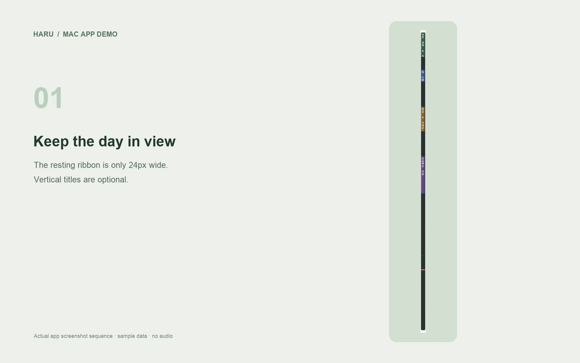

# 제품 미디어

## 촬영 원칙

`npm run demo`로 실행한 실제 Mac 앱의 창을 캡처했습니다. Google 인증·개인 설정을 읽지 않는 별도 임시 userData를 사용하며 일정은 샘플입니다. 개인 일정, 계정 이메일, OAuth JSON, 토큰은 공개 미디어에 포함하지 않습니다.

- `screenshots/rail.png`: 기본 레일과 세로 제목.
- `screenshots/timeline.png`: 클릭 확장 화면.
- `screenshots/event-details.png`: 샘플 일정 상세.
- `screenshots/event-edit.png`, `event-saved.png`: 샘플 제목 수정과 결과.
- `screenshots/settings.png`, `settings-adjusted.png`: 배경·투명도 옵션.
- `screenshots/rail-transparent.png`: 배경 없는 레일.
- `*-card.png`: 실제 원본에서 상세·설정 카드만 자른 이미지.

창 캡처에는 별도 현재 시간 삼각형 창이 포함되지 않을 수 있습니다. 원본 스크린샷을 다른 UI처럼 꾸미거나 실제 계정 검증 화면으로 설명하지 않습니다.

## 영상 형식

MP4는 실제 앱의 단계별 스크린샷을 3초씩 보여 주는 **화면 캡처 안내 영상**입니다. 연속 녹화·실시간 클릭 영상은 아닙니다. 텍스트 안내는 영어이며 앱 UI는 한국어입니다. Google 캘린더 쓰기나 실제 회의 참가를 시연하지 않습니다.

- `01-ribbon.mp4`: 레일 → 확장 → 복귀 (약 12초).
- `02-event-edit.mp4`: 상세 → 샘플 수정 → 저장 (약 15초).
- `03-appearance.mp4`: 설정 → 표시 조절 → 배경 없는 레일 (약 12초).

## 재생성

새 UI를 촬영할 때 원본 PNG를 같은 이름으로 저장합니다. 화면을 바꾼 뒤 실제 상태를 확인하고 캡처하세요. 스크린샷은 자동으로 재촬영되지 않습니다.

```sh
python3 -m pip install Pillow
python3 scripts/render-product-media.py
```

macOS의 Arial 폰트와 `ffmpeg`가 필요합니다. 스크립트는 로고·제품 소개 이미지·카드 크롭·MP4·GIF를 생성합니다. 앱의 네트워크 통신이나 Google 계정에 접근하지 않습니다.

코드로 그린 로고는 레일·일정·현재 시간 표시를 표현합니다. 전체 미디어는 이 저장소의 MIT 라이선스로 제공됩니다.

## 사용 예시 영상

기존 안내 영상은 이전 디자인(v0.0.2)의 샘플 화면을 단계별로 보여 줍니다. 최신 기능·디자인은 README와 사용법을 기준으로 보세요.

| 영상 | 흐름 |
| --- | --- |
| [레일 펼치기·접기 — MP4](assets/videos/01-ribbon.mp4) | 레일 → 클릭 확장 → 복귀 |
| [일정 확인·수정 — MP4](assets/videos/02-event-edit.mp4) | 샘플 일정 → 제목 수정 → 저장 |
| [화면 꾸미기 — MP4](assets/videos/03-appearance.mp4) | 설정 → 배경·투명도 → 축소 |



새 macOS 디자인: [밝은·어두운 화면](assets/redesign-preview.png). 생성·할일 화면: [샘플](assets/screenshots/create-and-tasks.png). 패키지 설정 버전: [v0.0.3](assets/screenshots/v0.0.3-settings.png).
